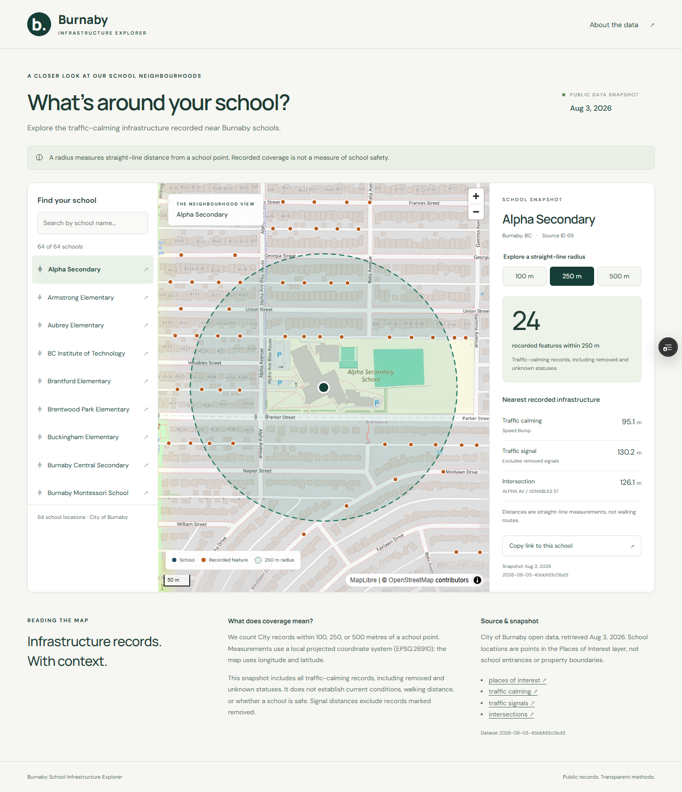
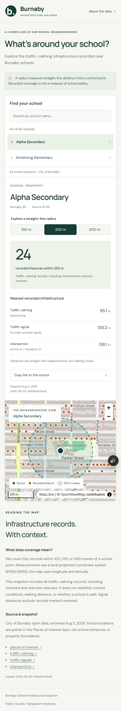

# Sprint 1–2 implementation review

Date: 13 October 2026. Status: both sprint implementations verified locally and deployed publicly; GitHub-hosted CI passed for implementation commit `17fc041`.

## Demonstration

- [Public application](https://bby-infrastructure-explorer.vercel.app)
- [Interactive API documentation](https://bby-infrastructure-explorer.vercel.app/docs)
- Dataset: `2026-08-03-45bbfd3c0bd3`, 64 schools and 1,494 calming records.
- Alpha Secondary: 1 / 24 / 93 recorded features at 100 / 250 / 500 m; nearest calming feature 95.125 m (95.1 m displayed).

## Sprint 1

Shipped a product brief, desktop/mobile wireframes, design tokens, data dictionary, provenance and status decisions, and a committed stable school registry. The report cleaner now accepts a reviewed school-count expectation. Export verifies the raw manifest, every CSV join, geometry/CRS, counts, and nearest distances, and emits deterministic JSON with a checksum manifest and quality summary.

FastAPI exposes dataset metadata, paginated/searchable schools, school detail, bounded viewport features, health, and OpenAPI. Runtime startup verifies dataset integrity. Original data, CSVs, figures, and report were not refreshed or rewritten. Git metadata and the existing GitHub origin were already present, so no repository reinitialization was necessary.

## Sprint 2

Shipped a responsive React/TypeScript/MapLibre app: searchable school list, selectable map points, viewport-paged calming features, projected radius overlays, counts and nearest details, attribution, source date, status caveats, and inline straight-line/safety limitations. School/radius selection survives reload and browser back/forward through URL parameters. API errors offer retry; empty search offers recovery; the list works without map tiles.

Deployed both services to Vercel under one origin. The first deployment exposed a host-runtime mismatch: Vercel does not provide Python 3.11 in its build image. The API now uses Python 3.12 there; offline export remains tested under Python 3.11. The second deployment built and passed external checks. Public access is enabled for this newly created demo project. A Dockerfile is also provided, but its image has not been built in this session.

## Verification evidence

| Check | Result |
| --- | --- |
| Python contract/API tests | 32 passed |
| Frontend TypeScript and production build | Passed locally and on Vercel |
| Local browser suite | 10 passed across desktop Chromium and Pixel 7 viewport |
| Public preview browser checks | 4 passed: school journey and map selection on both viewports |
| Unauthenticated HTTP smoke checks | `/`, `/health`, metadata, school search, `/openapi.json`, `/docs`: HTTP 200 |
| Deterministic regeneration | Regenerated the same dataset version and bytes |
| Original cleaner with explicit expectation | 64 schools; wrote only to an ignored verification directory |
| Visual review | Desktop and mobile screenshots inspected; map, radius, detail, attribution, and recovery layouts checked |
| GitHub Actions | [Implementation run passed](https://github.com/Tommy-Ren/BBY-Infrastructure-Explorer/actions/runs/38367605415): Python tests, deterministic export, frontend build, browser suite |
| Vercel Web Analytics | Enabled; production analytics script and one test page-view POST returned HTTP 200 |

Browser checks found and fixed a mobile empty-state overlap, radio hit-target issue, MapLibre worker packaging problem, and lazy-loaded map CSS overriding the map container position. They include real API data, failed requests and retries, missing shared IDs, malformed radius, and unavailable map tiles. The frontend dependency audit reported no vulnerabilities during installation.

## Vercel agent setup

Followed https://vercel.com/get-started.md as requested. Installed Vercel CLI 63.1.2 globally and verified authentication. Installed/enabled `vercel@openai-curated` at user scope (plugin route; no duplicate standalone skills). Added the shared `https://mcp.vercel.com` endpoint to the existing user Codex configuration and completed OAuth. `codex mcp list` reports enabled/OAuth. The newly installed MCP tools are not exposed to this already-running chat, so the requested `search_vercel_documentation` and `list_teams` tool checks remain unverified until Codex refreshes/restarts. Deployment and account operations were verified through the CLI.

## Scope changes and next work

- Kept historical calming status inclusion to preserve report values, with explicit labels. This is not an “active inventory” release.
- Used Vercel Services and native Python hosting instead of requiring a container host. Database remains deferred.
- Live data refresh, comparisons, CSV download, cluster explanations, and deeper accessibility/performance work remain in later sprints.
- The lazy map bundle triggers Vite's size warning; it is separate from the initial app bundle. Optimize only with measured user impact.
- A test-client dependency emits a deprecation warning for `httpx`; tests pass. Migrate when updating the test stack.
- Implementation commit `17fc041` was pushed to `main`; GitHub Actions passed and the Git integration deployed it to Vercel production.
- This automated implementation session is not a measurement of solo-developer delivery velocity. Re-estimate future sprint effort after human review and a short user demonstration; the original 8–12 hours/week assumption remains unvalidated.

## Screenshots

